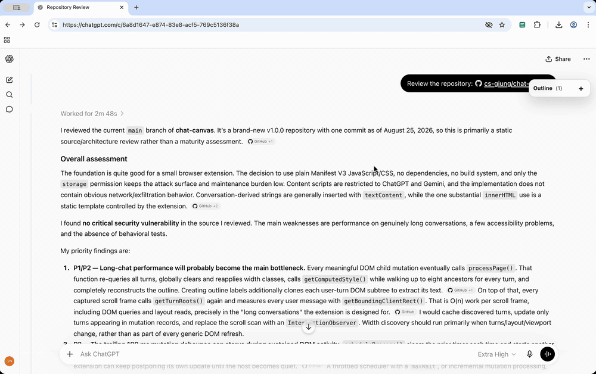

# Chat Canvas

A private, lightweight browser extension for making long AI conversations wider, collapsible, and easier to navigate.

[](https://github.com/cs-giung/chat-canvas/actions/workflows/validate.yml)
[](https://github.com/cs-giung/chat-canvas/releases/latest)
[](LICENSE)

## Demo

[](assets/chat-canvas-demo.mp4)

_Click the preview to open the higher-quality MP4 recording._

## Features

- Adjustable message and composer width from 55% to 100%
- Manually collapsible user messages and AI replies
- Collapse-all and expand-all controls
- Live conversation outline generated from your prompts
- Minimal outline mode showing only a small `+` button
- Markdown export with message roles, code blocks, tables, links, and TeX math
- Per-site controls for ChatGPT and Gemini
- Light mode, dark mode, and reduced-motion support
- No analytics, accounts, remote code, or network requests

## Install

### From a GitHub release

1. Download the `chat-canvas-v*.zip` archive from the [latest release](https://github.com/cs-giung/chat-canvas/releases/latest).
2. Unzip the archive.
3. Open `chrome://extensions` in Chrome or `edge://extensions` in Edge.
4. Enable **Developer mode**.
5. Select **Load unpacked** and choose the unzipped directory.
6. Pin **Chat Canvas**, then refresh any open ChatGPT or Gemini tabs.

### From source

```sh
git clone https://github.com/cs-giung/chat-canvas.git
```

Load the cloned `chat-canvas` directory as an unpacked extension using the steps above.

## Usage

- Adjust **Content width** from the extension popup.
- Click the subtle vertical bar beside a message to collapse it.
- Click a collapsed preview to expand it.
- Use the floating outline to jump to a prompt or collapse/expand all messages.
- Select `−` to minimize the outline to a small `+` button; select `+` to restore it.
- Click **Export .md** in the bottom-right corner to download the currently loaded conversation. This works even with the outline disabled. The file includes the page title, source URL, and separate user/AI messages.
- Before exporting, scroll through older messages to load available history and wait for the response to finish. Virtualized/unloaded messages cannot be recovered from the page; empty shells are skipped. Attachments and generated images are not downloaded, though available public image URLs are preserved.
- Disable individual features or supported sites from the popup at any time.

## Privacy and permissions

Chat Canvas requests only Chrome's `storage` permission, which stores and optionally browser-syncs preferences. Its content scripts are restricted to:

- `https://chatgpt.com/*`
- `https://gemini.google.com/*`

Rendered message text is processed temporarily in the page to create outline labels, collapsed previews, and user-requested Markdown downloads. Conversation text is never written to extension storage or transmitted by Chat Canvas; exported files are saved locally at your request. See [PRIVACY.md](PRIVACY.md) for the complete policy.

## Development

Chat Canvas uses plain JavaScript, CSS, and Manifest V3. There are no runtime dependencies and no build step. Browser regression tests use Playwright as a development dependency.

```sh
./scripts/validate.sh       # Static validation
./scripts/package.sh        # Create the versioned release archive in dist/
npm ci                     # Install test dependencies
npx playwright install chromium
npm test                   # Browser regression tests using local DOM fixtures
```

After changing extension files, reload Chat Canvas from `chrome://extensions` and refresh the target page.

To update an existing unpacked installation, replace its files with the updated source (or run `git pull` in the cloned directory), select **Reload** for Chat Canvas in `chrome://extensions`, and refresh your chat tabs. Reloading the extension alone does not update content scripts already running in open tabs.

The browser tests cover old and new ChatGPT message attributes, nested width constraints, streaming, virtualized message remounts, conversation navigation, preference changes, Gemini response alignment, minimized outlines, and Markdown downloads. These fixtures complement manual checks on signed-in sites. On ChatGPT, prompt labels for off-screen turns fill in when their text is first rendered; labels already seen remain available while that conversation is open.

AI products change their markup frequently. Platform selectors are grouped near the top of [`content/content.js`](content/content.js). Please include the affected site and browser version in bug reports.

## Contributing and security

- Read [CONTRIBUTING.md](CONTRIBUTING.md) before submitting a change.
- Report security concerns according to [SECURITY.md](SECURITY.md).
- Changes are documented in [CHANGELOG.md](CHANGELOG.md).

## Disclaimer

Chat Canvas is an independent open-source project. It is not affiliated with, endorsed by, or sponsored by OpenAI or Google. ChatGPT and Gemini are trademarks of their respective owners.

## License

[MIT](LICENSE)
